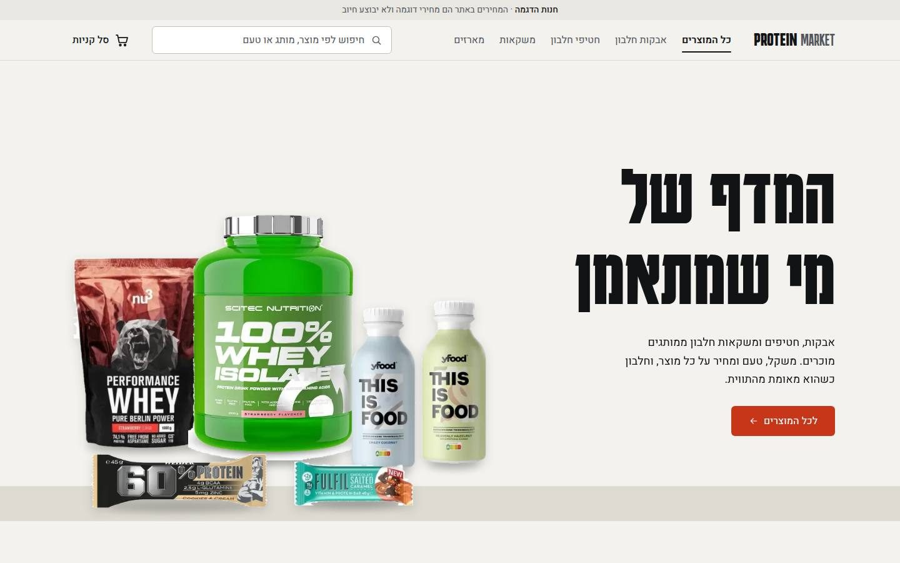
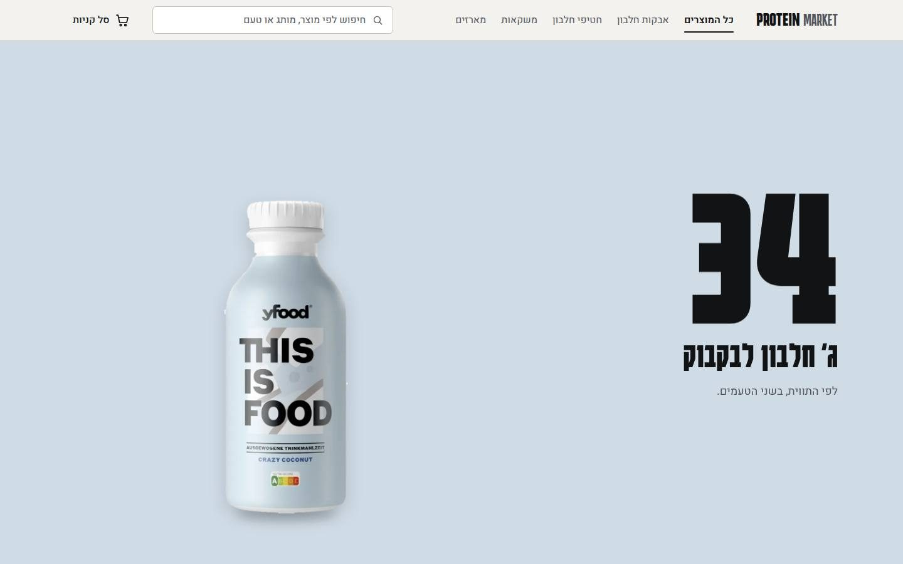
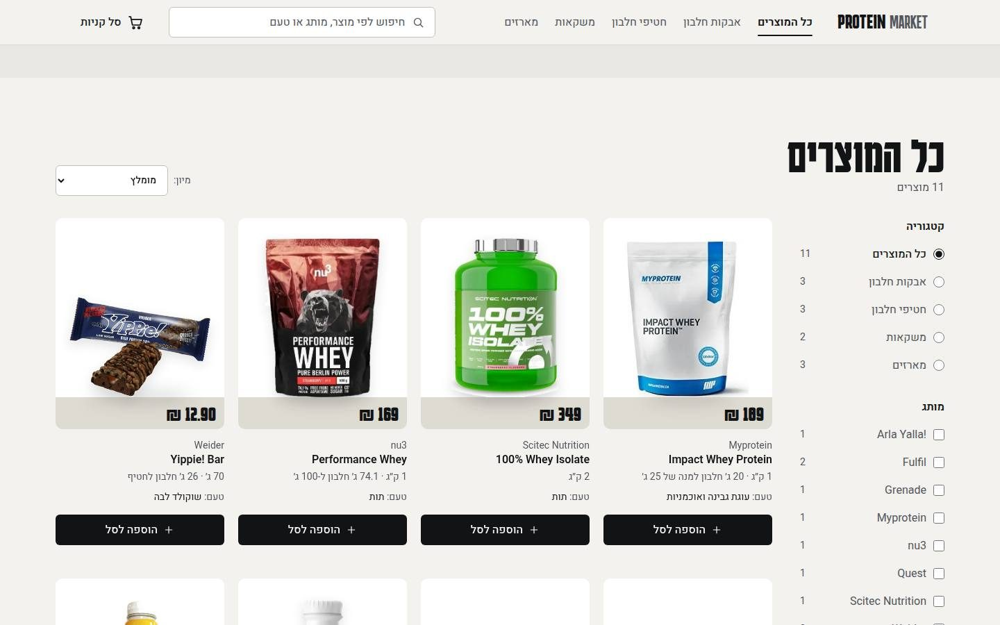
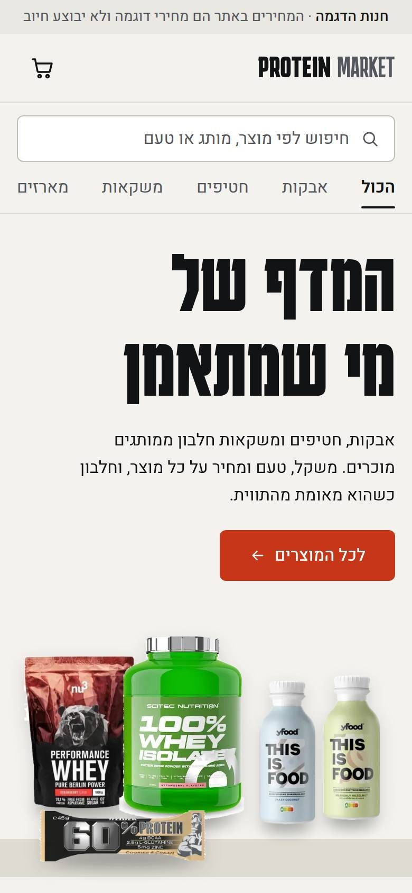

# Protein Market

A Hebrew (RTL) storefront for sports-nutrition products, built as a front-end and design portfolio piece.

> **Demo store.** Nothing here can be bought. Prices are sample prices, checkout creates a "sample order" with no payment, and the store has no connection to the brands shown.



## The idea

**"The shelf" (המדף).** Real packs from known brands stand side by side on one shelf line, with signage-scale Hebrew type and a palette taken from the packaging itself. The page has three high points with calm, shoppable stretches between them:

1. **Hero:** the headline rises out of a mask, the packs settle onto the shelf one after another, and on desktop they drift slightly with the pointer, by depth.
2. **Featured product story:** on desktop, a pinned stage driven entirely by CSS scroll timelines tells a four-beat story about one product line (meal in a bottle → 34 g protein per bottle → two flavours → the two bottles side by side). Phones get a dedicated still composition.
3. **Add to cart:** the product photo flies to the cart and the count answers when it lands.

| Featured story (desktop) | Catalog with shelf-edge price tags | Phone |
| --- | --- | --- |
|  |  |  |

## Features

- **Catalog:** 12 real products in 4 categories (powders, bars, drinks, multipacks), shown as 11 cards. Two flavours of the same line share one card with a flavour choice that swaps to that flavour's own photo.
- **Search** across brand, name, product type, flavour and category.
- **Filtering** by category (header tabs, sidebar or phone filter panel, footer links) and by brand, plus **sorting** by price. Cards reorder with view transitions. The result area keeps its height, so filtering never pulls the page up under the reader.
- **Cart:** add, change quantity and remove, in a side drawer (native `<dialog>`). The cart is saved in `localStorage` and synced across tabs, and checkout is a clearly labelled demo order.
- **Accessibility:**
  - Full RTL with logical CSS properties, and Latin brand names isolated with `<bdi>`.
  - Keyboard-operable filters and cart: focus moves into the drawer, Escape closes it, and focus returns to the cart button.
  - Visible focus states and 44px touch targets.
- **Motion that follows a plan** (Emil Kowalski's guidelines):
  - Only `transform` and `opacity`, on strong custom easing curves.
  - Hover motion only on fine pointers, and no React state updates on scroll or pointer move.
  - Full `prefers-reduced-motion` support: fades stay, movement goes, and the featured story becomes a still composition.
- **Honest product data:** brand, name, flavour and size match the photographed pack. Protein is shown only when it was read from the label; where sources conflict, it is omitted. No reviews, ratings, promotions or shipping promises.

## Tech stack

- [Next.js 16](https://nextjs.org) (App Router, Turbopack, static prerendering) with React 19 and TypeScript.
- [Tailwind CSS v4](https://tailwindcss.com) with design tokens in `app/globals.css` (`@theme`).
- `next/font` with **Karantina** (condensed Hebrew display) and **Heebo** (text).
- `next/image` for responsive images. The hero packs load eagerly with one high-priority image; the catalog loads lazily.
- Motion uses the platform, with no animation library: CSS transitions and `@starting-style`, CSS scroll-driven animations (`animation-timeline`), the View Transitions API, and the Web Animations API.
- State uses React context plus `useSyncExternalStore` over a small `localStorage` cart store.

## Getting started

Requirements: Node.js 20.9 or newer, and npm.

```bash
npm install
npm run dev      # http://localhost:3000
```

Production build:

```bash
npm run build
npm start
```

Lint:

```bash
npm run lint
```

## Project structure

```
app/
  page.tsx            storefront (hero, featured story, catalog, cart)
  credits/page.tsx    per-image sources and licences
  globals.css         tokens, hero shelf, scroll-driven story, drawer, reduced motion
components/
  store/              Hero, HeroShelf, Featured, Catalog, ProductCard, Filters, header, footer
  cart/               CartProvider, CartDrawer, CartLine
  ui/                 Button, QuantityStepper, Toast, Icon, EmptyState
lib/
  catalog.ts          products, categories, search, filter and sort
  cart-store.ts       localStorage-backed cart store
  fly-to-cart.ts      add-to-cart flight (Web Animations API)
scripts/
  cutouts.py          derives transparent pack cutouts from the photos (Pillow)
public/products/      product photos, cutouts and SOURCES.md
DESIGN.md             the design system (colours, type, layout, motion)
```

## Image credits and licences

- **Product photos:** [Open Food Facts](https://world.openfoodfacts.org) contributors, licensed [CC BY-SA 3.0](https://creativecommons.org/licenses/by-sa/3.0/).
  - Changes: white margins trimmed, resized for the web, and the Quest photo cropped to the box.
  - Seven photos also exist as transparent cutouts in `public/products/cutouts/`, derived from the same photos by `scripts/cutouts.py`. Only the background is removed; the packaging is not edited.
  - These adapted files are shared under the same CC BY-SA 3.0 licence.
  - Per-file sources and barcodes are in [`public/products/SOURCES.md`](public/products/SOURCES.md) and on the site's `/credits` page.
- **`public/hero/protein-shake-kitchen.jpg`:** "Woman measures protein powder into a shaker cup…" by Shixart1985, [Wikimedia Commons](https://commons.wikimedia.org/wiki/File:Woman_measures_protein_powder_into_a_shaker_cup_in_a_kitchen_setting_while_preparing_for_a_workout.jpg), licensed [CC BY 2.0](https://creativecommons.org/licenses/by/2.0/). It is kept in the repository but is not shown on the current site.
- **Screenshots in `docs/`:** they include the product photos above, so the same attribution applies.
- **Fonts:** Karantina and Heebo, both under the SIL Open Font License, served through Google Fonts via `next/font`.

Brand names and packaging belong to their owners. They appear only to show real products in a demo, with no affiliation or endorsement implied.
